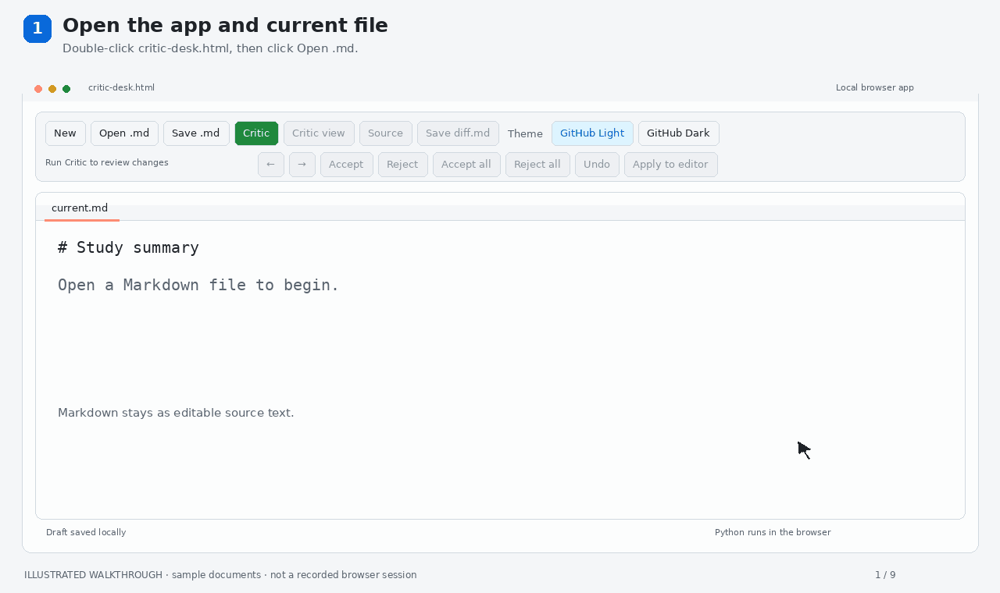

# critic markdown editor

 Light-weighted IDE to edit markdown with critic markers and compare revisions. No installation, terminal, or server is needed.

 
## how to install

Download `critic-desk.html` and double-click it to open it in your browser.

## how to use

When need to compare to files, click **Critic** and select the original Markdown file and new temporal diff.md will show.

Review the colored changes and you can also edit directly in **Critic view**. Click a change, then **Accept** or **Reject**. **Undo** to reverse an edit or decision.

**Save diff.md** will download current diff.md. **Apply to editor** copies the reviewed text into the source document.

## demo

